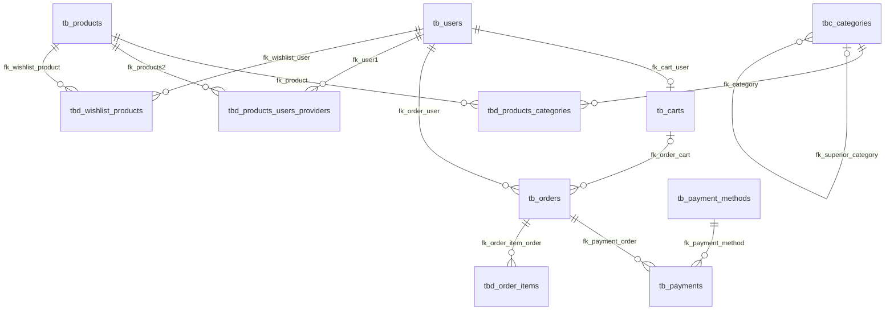

# Diccionario integral de datos y arquitectura: db_test

> Fuente: 151026.sql | Base: db_test | Motor: MySQL 8.0.36

## Resumen ejecutivo

El esquema representa un sistema de comercio electronico con cuentas, catalogo, categorias, relaciones comerciales, carrito, pedidos, pagos, listas de deseos y auditoria. Incluye 14 tablas, 99 columnas, 6 vistas finales, 15 triggers, 13 claves foraneas y cuatro CHECK. No aparecen procedimientos, funciones ni eventos en este respaldo. Estas conclusiones describen el archivo, no la aplicacion ni una instancia productiva.

## Alcance y método

Fuente única del análisis estructural: [`151026.sql`](Practica03/backups/151026.sql). Se analizaron las sentencias DDL, vistas, triggers, restricciones e índices. Los `INSERT` del respaldo se excluyen de este documento; los ejemplos son ficticios. El archivo es un dump, no una conexión a una instancia, por lo que no acredita que todos los objetos se hayan importado con éxito.

## 1. Naturaleza y descripción general

`db_test` se crea con `utf8mb4`, colación `utf8mb4_0900_ai_ci`, cifrado predeterminado desactivado y tablas InnoDB. El encabezado indica MySQL Server 8.0.36 y MySQL dump 10.13. Es una base relacional con orientación clara a comercio electrónico: catálogo de productos y categorías, relaciones con usuarios por propiedad/venta/distribución, carritos/listas de deseos, pedidos, líneas de pedido, métodos de pago y pagos. Incluye además bitácora general y una tabla específica de trazabilidad de productos.

**Propósito funcional inferido del esquema:** soportar catálogo y descubrimiento de artículos, relaciones comerciales entre usuarios y productos, selección de productos en carrito/lista de deseos, formalización y consulta de pedidos, registro de pagos y consulta operativa/auditora mediante vistas. El SQL no contiene procedimientos de compra completos, gestión logística, autenticación, autorización de roles, conciliación con pasarela, impuestos por jurisdicción, reservas de inventario ni reglas de transición de estados. No se puede asegurar que estas funciones estén implementadas fuera del archivo.

**Actores.** Confirmados por estructura: `tb_users` y registros que identifican a un usuario mediante FK; métodos de pago como catálogo. Inferidos: comprador (carrito, pedido, pago, wishlist), vendedor/propietario/distribuidor (ENUM `type_ownership`), administrador/operador (mantenimiento de catálogos y cuentas) y proceso de pago externo (referencia de transacción). El dump no define roles de aplicación. `db_user`/`USER()` en logs identifica contexto de cuenta/conexión MySQL según función SQL, no prueba la identidad humana.

**Datos y clasificación.** Personales/de cuenta: correo, nick, contraseña, dirección de envío, usuario asociado; el correo y dirección pueden ser datos personales. Credenciales: `password` (el esquema no demuestra hash). Comerciales: SKU, nombre/descripción, precio, stock, categorías, propiedad/oferta. Financieros: importes, moneda, pago, referencia, motivo de fallo, método. Operativos: estados, fechas, disponibilidad, cantidades. Auditoría: `tb_logs`, `tbh_trazabilidad_productos`. No se definen datos de tarjeta ni cuenta bancaria. JSON sólo aparece en el detalle de trazabilidad.

**Arquitectura y limites.** Modelo relacional con entidades `tb_*`, catalogos `tbc_*`, asociaciones/detalles `tbd_*` e historial `tbh_*`. `tbd_order_items.product_offer_ID` parece un identificador de oferta, pero no existe tabla de ofertas ni FK que confirme su destino. Hay dos modelos wishlist con garantias distintas. `tb_payments.user_payment_method_ID` tampoco tiene FK.

**Nomenclatura.** Prefijos aproximados: `tb` entidad, `tbc` catálogo, `tbd` detalle/asociación, `tbh` historial; `vw` vista; `trg` trigger. Conviven `ID`, `user_ID`, `user_id`, mayúsculas/minúsculas, inglés y español; la comparación de identificadores en MySQL depende del entorno/colación en ciertos contextos. Restricciones usan prefijos `fk_`, `chk_`, `uk_`/`uq_`, índices `idx_`.

## 2. Inventario de objetos

| Tipo | Cantidad | Objetos |
|---|---:|---|
| Tablas | 14 | `tb_carts`, `tb_logs`, `tb_orders`, `tb_payment_methods`, `tb_payments`, `tb_products`, `tb_users`, `tbc_categories`, `tbd_order_items`, `tbd_products_categories`, `tbd_products_users_providers`, `tbd_users_wishlist_products`, `tbd_wishlist_products`, `tbh_trazabilidad_productos` |
| Vistas finales | 6 | `vw_total_products_by_category`, `vw_trazabilidad_categorias`, `vw_trazabilidad_productos`, `vw_trazabilidad_productos_categorias`, `vw_trazabilidad_proveedores`, `vw_trazabilidad_usuarios` |
| Triggers | 15 | Tres operaciones DML en cinco tablas: productos, usuarios, categorias, relacion producto-categoria y proveedores |
| Claves foráneas | 13 | Enumeradas en §5 |
| Claves primarias | 14 | Una por tabla; `tbd_order_items`, `tbd_products_categories`, `tbd_products_users_providers`, ambas wishlist usan PK compuesta |
| Índices únicos | 7 | `uk_cart_user`, `uq_payment_method_code`, `uq_payment_reference`, `SKU`, `email`, `nickname`, `name` (sin contar PKs) |
| Indices secundarios explicitos | 14 | Indexes non-unique declared outside primary keys |
| Columnas generadas | 1 | `tbd_order_items.line_total` almacenada |
| CHECK | 4 | `chk_order_amounts`, `chk_payment_amount`, `chk_order_item_price`, `chk_order_item_quantity` |
| ENUM | 6 campos | `tb_logs.table_operation`, `tb_logs.operation`, `tb_orders.order_status`, `tb_payments.payment_status`, `tbd_products_users_providers.type_ownership`, `tbh_trazabilidad_productos.accion` (6 columnas ENUM) |
| JSON / BIT | 1 JSON, 8 BIT | `detalle_cambio`; estados booleanos representados como `BIT(1)` |

El recuento de triggers del archivo puede incluir múltiples bloques de creación para la misma tabla; el catálogo individual está en §7. No hay `CREATE PROCEDURE`, `FUNCTION` ni `EVENT` identificados. Los `DEFINER` observados usan `root`@`localhost` en los triggers.

## 3. Diccionario de datos por tabla

En las tablas siguientes, “—” en clave significa que no se declara clave/indexación para ese campo individual. `NULL`/`NOT NULL`, tipo y default reproducen la definición. En “Ejemplo” se usan valores ficticios. Una FK se declara sólo donde el SQL la contiene.

### `tb_users` — Cuentas de usuario
Entidad principal de cuentas; participa como comprador y usuario comercial. Tiene triggers AFTER de auditoria, no validaciones de campos. El nombre `password` no demuestra hash.

| Nombre físico | Nombre lógico | Tipo de dato | Naturaleza | Significado funcional | Clave | Nulabilidad | Valor predeterminado | Generación | Regla o restricción | Ejemplo ilustrativo | Observaciones |
|---|---|---|---|---|---|---|---|---|---|---|---|
| ID | Identificador de usuario | int | Identificador | Clave técnica de cuenta | PK | NOT NULL | ninguno | AUTO_INCREMENT | PK | 42 | Sin FK saliente |
| email | Correo | varchar(80) | Personal/cuenta | Dirección de contacto/identificación | UNIQUE `email` | NOT NULL | ninguno | — | único | usuario@example.test | Dato personal; límites de longitud |
| nick | Alias | varchar(100) | Cuenta | Nombre visible | UNIQUE `nickname` | NOT NULL | ninguno | — | único | tienda_demo | Índice declara nombre `nickname` sobre `nick` |
| password | Contraseña/credencial | varchar(255) | Credencial | Secreto de autenticación previsto | — | NOT NULL | ninguno | — | no hay regla de hash declarada | hash_ficticio | Nunca asumir almacenamiento seguro por el nombre |
| creation_date | Creación | datetime | Fecha | Alta de cuenta | — | NOT NULL | CURRENT_TIMESTAMP | automática al insertar | — | 2026-01-15 10:00:00 | — |
| last_update | Última actualización | datetime | Fecha | Actualización registrada | — | NULL | NULL | no tiene `ON UPDATE` | — | 2026-02-01 10:00:00 | La aplicación tendría que mantenerla |
| last_login | Último acceso | datetime | Fecha operativa | Marca de inicio de sesión | — | NULL | NULL | — | — | 2026-02-01 10:00:00 | No prueba auditoría de sesiones |
| status | Estado activo | bit(1) | Estado | Indicador binario de cuenta | — | NOT NULL | b'1' | — | BIT | b'1' | El significado exacto de 0/1 se infiere |

### `tb_products` — Productos
Entidad central del catálogo. `SKU` es único. Tiene precio y stock actual, pero no FK de categoría; se relaciona mediante tabla asociativa. Los triggers AFTER registran operaciones en el log general.

| Nombre físico | Nombre lógico | Tipo de dato | Naturaleza | Significado funcional | Clave | Nulabilidad | Valor predeterminado | Generación | Regla o restricción | Ejemplo ilustrativo | Observaciones |
|---|---|---|---|---|---|---|---|---|---|---|---|
| ID | Identificador de producto | int unsigned | Identificador | Clave técnica | PK | NOT NULL | ninguno | AUTO_INCREMENT | PK | 100 | — |
| SKU | Código SKU | varchar(50) | Catálogo | Código de producto | UNIQUE `SKU` | NOT NULL | ninguno | — | único | DEMO-100 | — |
| name | Nombre | varchar(250) | Descriptivo | Nombre comercial | — | NOT NULL | ninguno | — | — | Artículo demostrativo | — |
| description | Descripción | text | Descriptivo | Información extendida | — | NULL | NULL | — | — | Descripción ficticia | Puede contener texto libre |
| current_price | Precio vigente | decimal(10,2) | Importe | Precio actual | - | NOT NULL | 0.00 | - | Sin CHECK ni trigger que impida valores negativos | 199.90 | Sin moneda propia |
| current_stock | Existencia actual | int unsigned | Inventario | Existencia global reportada | — | NOT NULL | 0 | — | no negativo por tipo unsigned | 20 | No hay reserva ni actualización automática en SQL visible |
| status | Estado | bit(1) | Estado | Indicador de disponibilidad/actividad | — | NULL | b'1' | — | BIT | b'1' | A diferencia de otros estados, admite NULL |
| creation_date | Creación | datetime | Fecha | Alta del artículo | — | NOT NULL | CURRENT_TIMESTAMP | automática | — | 2026-01-15 10:00:00 | — |
| last_update | Actualización | datetime | Fecha | Último cambio | — | NOT NULL | CURRENT_TIMESTAMP | ON UPDATE CURRENT_TIMESTAMP | — | 2026-02-01 10:00:00 | — |

### `tbc_categories` — Categorías
Catálogo jerárquico autorreferenciado. Puede categorizar productos mediante `tbd_products_categories`; la jerarquía padre-hija es nullable.

| Nombre físico | Nombre lógico | Tipo de dato | Naturaleza | Significado funcional | Clave | Nulabilidad | Valor predeterminado | Generación | Regla o restricción | Ejemplo ilustrativo | Observaciones |
|---|---|---|---|---|---|---|---|---|---|---|---|
| ID | Identificador | int unsigned | Identificador | Clave de categoría | PK | NOT NULL | ninguno | AUTO_INCREMENT | PK | 12 | — |
| name | Nombre | varchar(120) | Catálogo | Etiqueta de categoría | UNIQUE `name` | NOT NULL | ninguno | — | único | Electrónica demo | — |
| description | Descripción | text | Descriptivo | Detalle | — | NULL | NULL | — | — | Accesorios de ejemplo | — |
| sup_id_category | Categoría superior | int unsigned | Referencia | Padre jerárquico | FK `fk_superior_category` | NULL | NULL | — | autorreferencia a ID | 2 | Sin acción ON DELETE declarada |
| status | Estado | bit(1) | Estado | Activa/inactiva inferido | — | NOT NULL | b'1' | — | BIT | b'1' | — |
| creation_date | Creación | datetime | Fecha | Alta | — | NOT NULL | CURRENT_TIMESTAMP | automática | — | 2026-01-15 10:00:00 | — |
| last_update | Actualización | datetime | Fecha | Último cambio | — | NOT NULL | CURRENT_TIMESTAMP | ON UPDATE CURRENT_TIMESTAMP | — | 2026-02-01 10:00:00 | — |

### `tb_carts` — Carritos
Una fila de carrito por usuario debido a `uk_cart_user`; no contiene líneas de carrito. La asociación al usuario es obligatoria.

| Nombre físico | Nombre lógico | Tipo de dato | Naturaleza | Significado funcional | Clave | Nulabilidad | Valor predeterminado | Generación | Regla o restricción | Ejemplo ilustrativo | Observaciones |
|---|---|---|---|---|---|---|---|---|---|---|---|
| ID | Identificador de carrito | int unsigned | Identificador | Clave técnica | PK | NOT NULL | ninguno | AUTO_INCREMENT | PK | 7 | — |
| user_ID | Usuario dueño | int | Referencia | Cuenta asociada | UNIQUE `uk_cart_user`; FK `fk_cart_user` | NOT NULL | ninguno | — | máximo un carrito por usuario | 42 | — |
| creation_date | Creación | datetime | Fecha | Alta del carrito | — | NOT NULL | CURRENT_TIMESTAMP | automática | — | 2026-01-15 10:00:00 | — |
| last_update | Actualización | datetime | Fecha | Momento de cambio | — | NULL | NULL | ON UPDATE CURRENT_TIMESTAMP | — | 2026-02-01 10:00:00 | No hay detalle de productos asociado por FK |

### `tb_orders` — Pedidos
Cabecera transaccional. Guarda usuario, referencia opcional a carrito, estado, totales y dirección. No tiene líneas incorporadas: éstas están en `tbd_order_items`.

| Nombre físico | Nombre lógico | Tipo de dato | Naturaleza | Significado funcional | Clave | Nulabilidad | Valor predeterminado | Generación | Regla o restricción | Ejemplo ilustrativo | Observaciones |
|---|---|---|---|---|---|---|---|---|---|---|---|
| ID | Identificador | int unsigned | Identificador | Pedido | PK | NOT NULL | ninguno | AUTO_INCREMENT | PK | 900 | — |
| user_ID | Usuario comprador | int | Referencia | Cuenta que figura en pedido | FK `fk_order_user` | NOT NULL | ninguno | — | FK a users | 42 | — |
| cart_ID | Carrito origen | int unsigned | Referencia | Carrito vinculado | FK `fk_order_cart` | NULL | NULL | — | ON DELETE SET NULL | 7 | — |
| order_status | Estado del pedido | enum(pending, paid, processing, shipped, delivered, cancelled, refunded) | Estado controlado | Estado actual | — | NOT NULL | pending | — | ENUM | shipped | No se declara máquina de estados |
| subtotal | Subtotal | decimal(12,2) | Importe | Importe previo a ajustes | — | NOT NULL | 0.00 | — | `chk_order_amounts` >=0 | 100.00 | No se calcula automáticamente |
| tax_amount | Impuestos | decimal(12,2) | Importe | Impuesto total | — | NOT NULL | 0.00 | — | `chk_order_amounts` >=0 | 16.00 | No se define tasa |
| shipping_amount | Envío | decimal(12,2) | Importe | Cargo de envío | — | NOT NULL | 0.00 | — | `chk_order_amounts` >=0 | 10.00 | — |
| discount_amount | Descuento | decimal(12,2) | Importe | Descuento total | — | NOT NULL | 0.00 | — | `chk_order_amounts` >=0 | 5.00 | — |
| total_amount | Total | decimal(12,2) | Importe | Total declarado | — | NOT NULL | 0.00 | — | `chk_order_amounts` >=0 | 121.00 | No se fuerza igualdad con componentes |
| currency | Moneda | char(3) | Moneda | Código monetario | — | NOT NULL | MXN | — | longitud fija 3 | MXN | No hay catálogo/validación ISO |
| shipping_address | Dirección de envío | varchar(500) | Personal/operativa | Dirección usada en envío | — | NULL | NULL | — | — | Calle Ejemplo 10 | Dato personal; acceso restringido |
| creation_date | Creación | datetime | Fecha | Fecha de alta | — | NOT NULL | CURRENT_TIMESTAMP | automática | — | 2026-01-15 10:00:00 | — |
| last_update | Actualización | datetime | Fecha | Última actualización | — | NULL | NULL | ON UPDATE CURRENT_TIMESTAMP | — | 2026-02-01 10:00:00 | — |

### `tbd_order_items` — Detalle de pedido
Asociación entre pedido y oferta; PK compuesta limita una línea por oferta por pedido. `line_total` es calculado y almacenado.

| Nombre físico | Nombre lógico | Tipo de dato | Naturaleza | Significado funcional | Clave | Nulabilidad | Valor predeterminado | Generación | Regla o restricción | Ejemplo ilustrativo | Observaciones |
|---|---|---|---|---|---|---|---|---|---|---|---|
| order_ID | Pedido | int unsigned | Referencia | Cabecera | PK compuesta; FK `fk_order_item_order` | NOT NULL | ninguno | — | ON DELETE CASCADE | 900 | — |
| product_offer_ID | Oferta | int unsigned | Referencia | Oferta vendida | PK compuesta; índice/FK implícita `fk_order_item_offer` no declarada en la salida DDL como FK | NOT NULL | ninguno | — | PK compuesta | 33 | La definición muestra índice `fk_order_item_offer`, no constraint FOREIGN KEY en el extracto DDL |
| quantity | Cantidad | int unsigned | Cantidad | Unidades de línea | — | NOT NULL | 1 | — | CHECK >0 | 2 | unsigned ya excluye negativos |
| unit_price | Precio unitario | decimal(12,2) | Importe | Precio congelado para línea | — | NOT NULL | ninguno | — | CHECK >=0 | 49.95 | Snapshot inferido por función de línea |
| line_total | Total de línea | decimal(12,2) | Importe calculado | Cantidad por precio unitario | — | NOT NULL calculado | expresión | GENERATED ALWAYS AS (quantity * unit_price) STORED | no editable directamente | 99.90 | — |
| creation_date | Creación | datetime | Fecha | Registro de línea | — | NOT NULL | CURRENT_TIMESTAMP | automática | — | 2026-01-15 10:00:00 | — |

### `tb_payment_methods` — Métodos de pago
Catálogo habilitable de métodos. Su `code` es único; no almacena credenciales de pago.

| Nombre físico | Nombre lógico | Tipo de dato | Naturaleza | Significado funcional | Clave | Nulabilidad | Valor predeterminado | Generación | Regla o restricción | Ejemplo ilustrativo | Observaciones |
|---|---|---|---|---|---|---|---|---|---|---|---|
| ID | Identificador | int unsigned | Identificador | Método | PK | NOT NULL | ninguno | AUTO_INCREMENT | PK | 3 | — |
| code | Código | varchar(30) | Catálogo | Identificador legible | UNIQUE `uq_payment_method_code` | NOT NULL | ninguno | — | único | wallet_demo | — |
| name | Nombre | varchar(80) | Descriptivo | Etiqueta de método | — | NOT NULL | ninguno | — | — | Billetera de prueba | — |
| status | Estado | bit(1) | Estado | Habilitación inferida | — | NOT NULL | b'1' | — | BIT | b'1' | — |
| creation_date | Creación | datetime | Fecha | Alta del método | — | NOT NULL | CURRENT_TIMESTAMP | automática | — | 2026-01-15 10:00:00 | — |

### `tb_payments` — Pagos
Intentos/operaciones de pago enlazados a pedido y método. La FK de método guardado por usuario no está declarada en la tabla.

| Nombre físico | Nombre lógico | Tipo de dato | Naturaleza | Significado funcional | Clave | Nulabilidad | Valor predeterminado | Generación | Regla o restricción | Ejemplo ilustrativo | Observaciones |
|---|---|---|---|---|---|---|---|---|---|---|---|
| ID | Identificador | int unsigned | Identificador | Pago | PK | NOT NULL | ninguno | AUTO_INCREMENT | PK | 81 | — |
| order_ID | Pedido | int unsigned | Referencia | Pedido pagado | FK `fk_payment_order` | NOT NULL | ninguno | — | FK | 900 | — |
| payment_method_ID | Método | int unsigned | Referencia | Tipo de pago | FK `fk_payment_method` | NOT NULL | ninguno | — | FK | 3 | — |
| user_payment_method_ID | Método del usuario | int unsigned | Referencia no impuesta | Posible instrumento almacenado | índice `fk_payment_user_method` | NULL | NULL | — | no hay tabla/FK presente | 2 | Interpretación por nombre solamente |
| amount | Importe | decimal(12,2) | Importe | Monto pagado/intento | — | NOT NULL | ninguno | — | CHECK >0 | 121.00 | — |
| currency | Moneda | char(3) | Moneda | Código monetario | — | NOT NULL | MXN | — | longitud 3 | MXN | — |
| payment_status | Estado | enum(pending, authorized, completed, failed, refunded, cancelled) | Estado | Estado del pago | — | NOT NULL | pending | — | ENUM | completed | — |
| transaction_reference | Referencia transacción | varchar(100) | Financiero/operativo | Identificador externo | UNIQUE `uq_payment_reference` | NULL | NULL | — | UNIQUE permite múltiples NULL en MySQL | TX-DEMO-81 | No equivale a datos de tarjeta |
| failure_reason | Motivo de fallo | varchar(255) | Operativo | Mensaje/código explicativo | — | NULL | NULL | — | — | rechazo simulado | Evitar secretos en texto |
| paid_date | Fecha de pago | datetime | Fecha | Momento de pago | — | NULL | NULL | — | — | 2026-01-15 10:05:00 | No se automatiza por cambio de estado |
| creation_date | Creación | datetime | Fecha | Alta del pago | — | NOT NULL | CURRENT_TIMESTAMP | automática | — | 2026-01-15 10:00:00 | — |
| last_update | Actualización | datetime | Fecha | Último cambio | — | NULL | NULL | ON UPDATE CURRENT_TIMESTAMP | — | 2026-01-15 10:05:00 | — |

### `tbd_products_categories` — Producto por categoría
Tabla puente muchos-a-muchos entre producto y categoría; conserva estado y fechas de la asociación.

| Nombre físico | Nombre lógico | Tipo de dato | Naturaleza | Significado funcional | Clave | Nulabilidad | Valor predeterminado | Generación | Regla o restricción | Ejemplo ilustrativo | Observaciones |
|---|---|---|---|---|---|---|---|---|---|---|---|
| category_ID | Categoría | int unsigned | Referencia | Categoría asociada | PK compuesta; FK `fk_category` | NOT NULL | ninguno | — | FK a `tbc_categories.ID` | 12 | — |
| product_ID | Producto | int unsigned | Referencia | Producto asociado | PK compuesta; FK `fk_product` | NOT NULL | ninguno | — | FK a `tb_products.ID` | 100 | — |
| status | Estado relación | bit(1) | Estado | Asociación activa inferida | — | NOT NULL | b'1' | — | BIT | b'1' | Vista de conteo filtra status=1 |
| creation_date | Creación | datetime | Fecha | Alta de asociación | — | NOT NULL | CURRENT_TIMESTAMP | automática | — | 2026-01-15 10:00:00 | — |
| last_update | Actualización | datetime | Fecha | Cambio de asociación | — | NOT NULL | CURRENT_TIMESTAMP | ON UPDATE CURRENT_TIMESTAMP | — | 2026-02-01 10:00:00 | — |

### `tbd_products_users_providers` — Usuarios relacionados con productos
Tabla puente usuario-producto con función comercial mediante ENUM Owner/Seller/Distributor y disponibilidad. PK compuesta impide dos relaciones simultáneas de distinto tipo para el mismo par.

| Nombre físico | Nombre lógico | Tipo de dato | Naturaleza | Significado funcional | Clave | Nulabilidad | Valor predeterminado | Generación | Regla o restricción | Ejemplo ilustrativo | Observaciones |
|---|---|---|---|---|---|---|---|---|---|---|---|
| user_ID | Usuario | int | Referencia | Actor comercial | PK compuesta; FK `fk_user1` | NOT NULL | ninguno | — | FK a users | 42 | — |
| product_ID | Producto | int unsigned | Referencia | Artículo relacionado | PK compuesta; FK `fk_products2` | NOT NULL | ninguno | — | FK a products | 100 | — |
| type_ownership | Tipo de relación | enum(Owner, Seller, Distributor) | Estado/rol comercial | Naturaleza del vínculo | — | NULL | NULL | — | ENUM | Seller | Aunque el nombre sugiera tipo, es una relación comercial |
| status | Estado | bit(1) | Estado | Relación vigente inferida | — | NOT NULL | b'1' | — | BIT | b'1' | — |
| available_date | Disponibilidad | datetime | Fecha | Inicio de disponibilidad | — | NOT NULL | ninguno | — | — | 2026-02-01 00:00:00 | — |
| creation_date | Creación | datetime | Fecha | Alta | — | NOT NULL | CURRENT_TIMESTAMP | automática | — | 2026-01-15 10:00:00 | — |
| last_update | Actualización | datetime | Fecha | Cambio | — | NOT NULL | CURRENT_TIMESTAMP | ON UPDATE CURRENT_TIMESTAMP | — | 2026-02-01 10:00:00 | — |

### `tbd_wishlist_products` — Lista de deseos simple
Asociación usuario-producto con PK compuesta y FKs reales; no incluye estado activo. Convive con `tbd_users_wishlist_products`.

| Nombre físico | Nombre lógico | Tipo de dato | Naturaleza | Significado funcional | Clave | Nulabilidad | Valor predeterminado | Generación | Regla o restricción | Ejemplo ilustrativo | Observaciones |
|---|---|---|---|---|---|---|---|---|---|---|---|
| user_ID | Usuario | int | Referencia | Cuenta dueña | PK compuesta; FK `fk_wishlist_user` | NOT NULL | ninguno | — | FK users | 42 | — |
| product_ID | Producto | int unsigned | Referencia | Producto deseado | PK compuesta; FK `fk_wishlist_product` | NOT NULL | ninguno | — | FK products | 100 | — |
| creation_date | Creación | datetime | Fecha | Alta de asociación | — | NOT NULL | CURRENT_TIMESTAMP | automática | — | 2026-01-15 10:00:00 | — |

### `tbd_users_wishlist_products` — Lista de deseos con estado
Otra asociación usuario-producto. No declara PK referencial ni FK; usa nombres en minúsculas y estado lógico.

| Nombre físico | Nombre lógico | Tipo de dato | Naturaleza | Significado funcional | Clave | Nulabilidad | Valor predeterminado | Generación | Regla o restricción | Ejemplo ilustrativo | Observaciones |
|---|---|---|---|---|---|---|---|---|---|---|---|
| user_id | Usuario | int unsigned | Referencia no declarada | Cuenta relacionada | PK compuesta | NOT NULL | ninguno | — | PK compuesta | 42 | No FK declarada |
| product_id | Producto | int unsigned | Referencia no declarada | Producto relacionado | PK compuesta | NOT NULL | ninguno | — | PK compuesta | 100 | No FK declarada |
| is_active | Activa | bit(1) | Estado | Vigencia de wishlist | — | NOT NULL | b'1' | — | BIT | b'1' | — |
| created_date | Creación | datetime | Fecha | Alta | — | NOT NULL | CURRENT_TIMESTAMP | automática | — | 2026-01-15 10:00:00 | — |
| updated_date | Actualización | datetime | Fecha | Cambio | — | NOT NULL | CURRENT_TIMESTAMP | ON UPDATE CURRENT_TIMESTAMP | — | 2026-02-01 10:00:00 | — |

### `tb_logs` — Bitácora general
Registro operativo heterogéneo. Es texto descriptivo y metadatos; no conserva snapshots completos ni FK a usuario/tabla. Los triggers de auditoría escriben aquí.

| Nombre físico | Nombre lógico | Tipo de dato | Naturaleza | Significado funcional | Clave | Nulabilidad | Valor predeterminado | Generación | Regla o restricción | Ejemplo ilustrativo | Observaciones |
|---|---|---|---|---|---|---|---|---|---|---|---|
| ID | Identificador de log | int | Identificador | Evento registrado | PK | NOT NULL | ninguno | AUTO_INCREMENT | PK | 500 | — |
| table_name | Tabla afectada | varchar(100) | Auditoría | Nombre textual de tabla | — | NOT NULL | ninguno | — | texto libre | tb_products | Sin FK/metadato de catálogo |
| table_operation | Operación SQL | enum(INSERT, UPDATE, DELETE) | Auditoría | Tipo DML | — | NULL | NULL | — | ENUM | UPDATE | — |
| operation | Operación lógica | enum(Create, Read, Update, Delete) | Auditoría | Acción de negocio aproximada | — | NOT NULL | ninguno | — | ENUM | Update | Lecturas no son generadas por los triggers visibles |
| db_user | Usuario BD | varchar(80) | Auditoría | Contexto de conexión/SQL | — | NOT NULL | ninguno | — | — | app@localhost | No atribución personal fiable |
| operation_description | Descripción | text | Auditoría | Texto contextual/clave | — | NOT NULL | ninguno | — | libre | UPDATE en tb_products; clave=100 | Puede filtrar PII si los triggers la concatenan |
| operation_date | Fecha de operación | datetime | Fecha/auditoría | Momento registrado | índice doble | NOT NULL | CURRENT_TIMESTAMP | default automático | — | 2026-02-01 10:00:00 | Dos índices secundarios iguales declarados |
| operation_status | Resultado | bit(1) | Estado auditoría | Indicador de éxito | — | NULL | b'1' | — | BIT | b'1' | El trigger asigna 1; no registra fallos anteriores al AFTER |

### `tbh_trazabilidad_productos` — Historial específico de productos
Estructura especializada para registrar cambios por producto/usuario en JSON. El esquema no declara FKs ni triggers válidos que la alimenten: los triggers de proveedor encontrados apuntan a columnas diferentes de `tb_logs`.

| Nombre físico | Nombre lógico | Tipo de dato | Naturaleza | Significado funcional | Clave | Nulabilidad | Valor predeterminado | Generación | Regla o restricción | Ejemplo ilustrativo | Observaciones |
|---|---|---|---|---|---|---|---|---|---|---|---|
| id | Identificador | int unsigned | Identificador | Evento | PK | NOT NULL | ninguno | AUTO_INCREMENT | PK | 10 | — |
| tabla_afectada | Tabla afectada | varchar(64) | Auditoría | Tabla relacionada | — | NOT NULL | ninguno | — | texto | tbd_products_users_providers | — |
| producto_id | Producto | int unsigned | Referencia/auditoría | Producto involucrado | — | NOT NULL | ninguno | — | sin FK | 100 | No se asegura existencia actual |
| usuario_id | Usuario | int unsigned | Referencia/auditoría | Usuario involucrado | — | NOT NULL | ninguno | — | sin FK | 42 | — |
| accion | Acción | enum(INSERT, UPDATE, DELETE) | Auditoría | Tipo de cambio | — | NOT NULL | ninguno | — | ENUM | UPDATE | — |
| detalle_cambio | Detalle | json | Auditoría estructurada | Valores/cambios serializados | — | NULL | NULL | — | JSON | {"status_old":1,"status_new":0} | El campo admite valores anteriores/nuevos si quien escribe los incluye |
| fecha_registro | Fecha | datetime | Fecha/auditoría | Momento de registro | — | NOT NULL | CURRENT_TIMESTAMP | automática | — | 2026-02-01 10:00:00 | — |

## 4. Relaciones y modelo entidad-relación

### Relaciones declaradas por FK

| Origen | Destino | Restricción | Cardinalidad justificable | Nulabilidad y acción | Uso |
|---|---|---|---|---|---|
| `tb_carts.user_ID` | `tb_users.ID` | `fk_cart_user` | usuario 0..1 carrito; cada carrito 1 usuario (UNIQUE) | origen NOT NULL; sin acción explícita | Carrito de cuenta |
| `tb_orders.cart_ID` | `tb_carts.ID` | `fk_order_cart` | carrito 0..N pedidos; pedido 0..1 carrito | nullable; DELETE SET NULL | Vincula origen del pedido |
| `tb_orders.user_ID` | `tb_users.ID` | `fk_order_user` | usuario 0..N pedidos | NOT NULL; acción predeterminada RESTRICT/NO ACTION | Propietario del pedido |
| `tb_payments.payment_method_ID` | `tb_payment_methods.ID` | `fk_payment_method` | método 0..N pagos | NOT NULL; acción predeterminada | Método usado |
| `tb_payments.order_ID` | `tb_orders.ID` | `fk_payment_order` | pedido 0..N pagos | NOT NULL; acción predeterminada | Pago asociado |
| `tbc_categories.sup_id_category` | `tbc_categories.ID` | `fk_superior_category` | padre 0..N hijas; hija 0..1 padre | nullable; acción predeterminada | Jerarquía |
| `tbd_order_items.order_ID` | `tb_orders.ID` | `fk_order_item_order` | pedido 0..N líneas | NOT NULL; DELETE CASCADE | Detalle |
| `tbd_products_categories.category_ID` | `tbc_categories.ID` | `fk_category` | categoría 0..N asociaciones | NOT NULL; acción predeterminada | Puente categorías |
| `tbd_products_categories.product_ID` | `tb_products.ID` | `fk_product` | producto 0..N asociaciones | NOT NULL; acción predeterminada | Puente categorías |
| `tbd_products_users_providers.product_ID` | `tb_products.ID` | `fk_products2` | producto 0..N usuarios comerciales | NOT NULL; acción predeterminada | Roles Owner/Seller/Distributor |
| `tbd_products_users_providers.user_ID` | `tb_users.ID` | `fk_user1` | usuario 0..N productos | NOT NULL; acción predeterminada | Roles comerciales |
| `tbd_wishlist_products.product_ID` | `tb_products.ID` | `fk_wishlist_product` | producto 0..N wishlist | NOT NULL; acción predeterminada | Favoritos |
| `tbd_wishlist_products.user_ID` | `tb_users.ID` | `fk_wishlist_user` | usuario 0..N wishlist | NOT NULL; acción predeterminada | Favoritos |

No hay FK declarada para `tbd_order_items.product_offer_ID`, aunque existe índice llamado `fk_order_item_offer`; tampoco para columnas `tb_payments.user_payment_method_ID`, campos de `tbd_users_wishlist_products` ni `tbh_trazabilidad_productos`. No deben representarse como relaciones confirmadas.



Puentes muchos-a-muchos confirmados: producto-categoría; usuario-producto comercial; usuario-producto wishlist simple. `tbd_order_items` conecta pedido con oferta en su clave, pero el lado oferta carece de FK real. La wishlist de estado parece representar otra relación M:N, sin integridad referencial declarada.

## 5. Vistas

Se documentan las seis definiciones finales `CREATE OR REPLACE VIEW`. Antes aparecen placeholders de exportacion con `SELECT 1`; las consultas posteriores son las definiciones funcionales.

| Vista | Definicion real y uso |
|---|---|
| `vw_total_products_by_category` | Categorias LEFT JOIN asociaciones producto-categoria activas (`status=1`), agrupa por categoria y cuenta `product_ID`. No filtra status del producto ni cuenta DISTINCT. |
| `vw_trazabilidad_categorias` | Proyecta campos de `tb_logs` donde `table_name='tbc_categories'` y `operation_status=1`. Bitacora, no snapshot de categoria. |
| `vw_trazabilidad_productos` | Proyecta log_id, operacion, usuario BD, descripcion, fecha y estado desde `tb_logs` para `tb_products`. |
| `vw_trazabilidad_productos_categorias` | Proyecta campos de `tb_logs` para `tbd_products_categories`, filtrando estado 1. |
| `vw_trazabilidad_proveedores` | LEFT JOIN asociacion proveedor con logs por tabla y `LIKE` de IDs en descripcion; salida combina datos del vinculo y evento. Matching fragil, puede duplicar/falsamente asociar filas. |
| `vw_trazabilidad_usuarios` | Proyecta campos de `tb_logs` filtrados por tabla `tb_users` y status 1. |

No se definen vistas finales para pedidos o pagos en este respaldo. Todas son vistas no materializadas.

## 6. Triggers, reglas automáticas y fallos

Se declaran 15 triggers AFTER, tres por cada tabla de productos, usuarios, categorias, relaciones producto-categoria y relaciones de proveedores, para INSERT/UPDATE/DELETE. No hay triggers BEFORE.

| Trigger | Momento/tabla | Efecto | Limitaciones |
|---|---|---|---|
| `trg_tb_products_after_insert` | AFTER INSERT `tb_products` | Log Create con ID y nombre | Sin snapshot completo |
| `trg_tb_products_after_update` | AFTER UPDATE `tb_products` | Log Update con ID/nombre nuevo | No valores OLD/NEW completos |
| `trg_tb_products_after_delete` | AFTER DELETE `tb_products` | Log Delete con ID/nombre OLD | No fila completa |
| `trg_tb_users_after_insert/update/delete` | AFTER DML `tb_users` (tres triggers) | Logs Create/Update/Delete con ID y nick | Puede contener PII; no snapshot |
| `trg_tbc_categories_after_insert/update/delete` | AFTER DML `tbc_categories` (tres triggers) | Logs de ID/nombre | No snapshot completo |
| `trg_tbd_prod_cat_after_insert/update/delete` | AFTER DML `tbd_products_categories` (tres triggers) | Logs de IDs producto/categoria | No cambios OLD/NEW |
| `trg_after_insert_products_users_providers` | AFTER INSERT vinculo proveedor | Intenta log JSON | Columnas `product_id`, `user_id`, `action`, `details` no existen en `tb_logs` |
| `trg_after_update_products_users_providers` | AFTER UPDATE vinculo proveedor | Intenta log de antes/despues | Mismas columnas incompatibles |
| `trg_after_delete_products_users_providers` | AFTER DELETE vinculo proveedor | Intenta log de relacion eliminada | Mismas columnas incompatibles |

Los triggers escriben en `tb_logs` dentro de la transaccion. Las referencias a columnas inexistentes pueden impedir crear los triggers o causar error al ejecutarlos, segun validacion del servidor. `tbh_trazabilidad_productos` no es el destino de esos triggers. No hay reglas trigger de stock, pedido, pago o transicion de estado.

## 7. Auditoría y trazabilidad

`tb_logs` 
Es una bitácora general DML con actor de base de datos aproximado, tabla/operación/fecha y descripción textual; no tiene FK a usuario o tabla, ni columnas OLD/NEW, ni JSON, ni correlación de transacción. En algunos triggers la descripción incluye atributos como nombre/nick; otros sólo clave. El propio contenido de los registros insertados en el dump se omite aquí por privacidad.

`tbh_trazabilidad_productos` 
Está diseñada para asociar producto, usuario, tabla, acción, fecha y JSON opcional. El tipo JSON permite guardar snapshots/diferencias, y el trigger proveedor propone OLD/NEW en los detalles, pero se dirige a columnas inexistentes de `tb_logs`; por tanto no se puede afirmar que la tabla histórica se alimente correctamente. No hay FKs ni restricciones de retención/inmutabilidad.

La cobertura es parcial: cinco tablas tienen triggers. Carritos, pedidos, pagos, metodos, lineas, wishlists e historial no tienen triggers en este respaldo. En general el log no permite reconstruir filas borradas ni valores OLD/NEW; `db_user` tampoco identifica necesariamente a una persona.

## 8. Reglas de negocio e integridad

| Regla comprobable | Fuente | Alcance |
|---|---|---|
| Un usuario puede tener como máximo un carrito | UNIQUE `uk_cart_user` | `tb_carts` |
| Producto SKU, correo, nick, nombre categoría, código método únicos | UNIQUE declarados | Cada catálogo indicado |
| Las claves relacionadas deben existir | 13 FKs | Sólo relaciones enumeradas en §4 |
| Borrar pedido elimina sus líneas | FK `fk_order_item_order` ON DELETE CASCADE | Detalle pedido |
| Borrar carrito deja pedido sin carrito | FK `fk_order_cart` ON DELETE SET NULL | Cabecera pedido |
| Cantidades de detalle >0 y precio unitario >=0 | CHECK | `tbd_order_items` |
| Importes de pedido >=0 | CHECK | Componentes y total independientemente |
| Importe pago >0 | CHECK | `tb_payments` |
| Estados permitidos | ENUM | pedido, pago, rol comercial, acciones log/historial |
| Total de línea = cantidad × precio | columna generada STORED | Detalle pedido |

| Categoría activa se cuenta sólo si vínculo status=1 | Vista | Consulta de conteo |

**No implementado o no verificable:** cálculo/reconciliación de total pedido, impuestos/descuentos, consumo/reserva de stock, coherencia entre `current_stock` y `available_stock`, moneda permitida, control de transición de estados, autorización del usuario, un pago por pedido, existencia de método de pago del usuario, relación real de oferta-producto, unicidad de un tipo de vínculo usuario-producto por separado y retención de auditoría. Son recomendaciones/hipótesis, no reglas del SQL.

## 9. Seguridad y privacidad

- `tb_users.password` es `varchar(255)` NOT NULL; el SQL no muestra hash, sal, algoritmo ni política. La aplicación debe almacenar hashes robustos y nunca texto claro.
- Email, nick y dirección de envío son datos personales. Las vistas de trazabilidad de carrito, wishlist, pedido, pago, proveedor y usuarios exponen correo y/o dirección; restringir SELECT por rol y evitar acceso general a vistas.
- Referencia de transacción y motivo de fallo pueden ser sensibles operativamente. No hay número de tarjeta/PAN/CVV en columnas definidas; no inferir su almacenamiento.
- Descripciones de log son `TEXT` libre y algunos triggers concatenan nombres/nicks. No incluir contraseñas, tokens, datos de pago ni datos personales innecesarios; definir acceso, retención, borrado/anonimización y protección contra manipulación.
- `DEFINER=root@localhost` en los triggers crea dependencia con cuenta privilegiada: usar un definidor de mínimos privilegios y verificar privilegios al migrar. El dump no define usuarios, grants ni roles; no se puede evaluar permisos efectivos.
- `CREATE DATABASE` indica `DEFAULT ENCRYPTION='N'`; no describe cifrado de disco, backups o transporte. Gestionarlos en infraestructura.

## 10. Indices y rendimiento

Las PK y claves UNIQUE se describen en las fichas. Los indices secundarios incluyen dos indices redundantes sobre `tb_logs.operation_date`, indices de pedidos por usuario/estado/carrito, pagos por pedido/estado/metodo, y soporte de FKs en categorias, detalle y tablas puente. `tbd_order_items.product_offer_ID` tiene indice, no FK.

Los indices declarados benefician joins y filtros por esas columnas. Los duplicados de fecha de logs elevan costo de escritura sin distinto prefijo util. La vista de proveedores busca IDs con `LIKE` de comodin inicial en descripciones textuales, operacion no indexable con B-tree convencional. Indices adicionales sobre historial por producto/fecha o usuario/fecha son recomendaciones sujetas a consultas y volumen reales.

## 11. Normalización y calidad

Las entidades usuario, producto, categoría, pedido, pago y método tienen identificadores y atributos propios, compatible en principio con 1FN (campos atómicos salvo JSON deliberado). Las tablas puente separan relaciones M:N; las PK compuestas impiden duplicados del par. `line_total` es derivado pero se declara como columna generada, evitando discrepancia manual. En `tb_orders`, valores agregados coexisten con líneas, de modo que existe duplicación potencial de importes y requiere consistencia de aplicación no declarada.

No se puede certificar 2FN/3FN global sin dependencias funcionales de negocio. Campos de tablas con PK simple dependen aparentemente de esa clave; en puente la PK compuesta permite dependencias del par. Posibles problemas: dos tablas de wishlist con el mismo concepto y políticas incompatibles; índice llamado FK sin constraint en detalle; relación de método guardado huérfana; historial sin FKs; log textual no estructurado; denominaciones mixtas; estado `BIT` nullable en producto; definiciones de timestamps inconsistentes; `tbd_products_users_providers` combina roles en una sola relación y su PK no permite tipos múltiples por pareja. Conservar el esquema original y planificar migraciones explícitas con limpieza y validación.

## 12. Glosario y mantenimiento

| Término | Uso en este esquema |
|---|---|
| Producto | Artículo de catálogo en `tb_products`, con SKU, precio y stock |
| Categoría | Clasificación jerárquica de producto en `tbc_categories` |
| Oferta | No existe entidad de oferta en este respaldo; `product_offer_ID` carece de destino confirmable |
| Propietario/vendedor/distribuidor | Valores de `type_ownership` para vínculo usuario-producto |
| Carrito | Registro único por usuario, sin líneas explícitas en el esquema |
| Pedido | Cabecera de compra con importes/estado y usuario |
| Detalle de pedido | Linea identificada por pedido y `product_offer_ID`, sin FK a oferta |
| Método de pago | Catálogo habilitable (`tb_payment_methods`) |
| Pago | Operación/intentó asociada a pedido y método |
| Lista de deseos | Dos modelos paralelos de asociación usuario-producto |
| Bitácora | `tb_logs`, registro textual de operaciones generales |
| Trazabilidad | Historial estructurado planeado en `tbh_trazabilidad_productos`; vistas homónimas muestran estado actual o logs |

Para mantenimiento: usar nombres consistentes (singular/plural, idioma y casing), documentar cambios y migraciones, mantener constraints/FKs alineados con las relaciones efectivas, definir ciclo de vida de estados, validar triggers en una instancia MySQL compatible, no utilizar root como definidor de producción, y revisar vistas con PII/permisos. Antes de confiar en la auditoría, corregir formalmente el desacuerdo entre triggers de proveedor y columnas de bitácora/historial.

## 13. Matriz de cobertura

### Tablas y campos

| Tabla | Estado | Campos incluidos |
|---|---|---|
| `tb_users` | Documentado | ID, email, nick, password, creation_date, last_update, last_login, status |
| `tb_products` | Documentado | ID, SKU, name, description, current_price, current_stock, status, creation_date, last_update |
| `tbc_categories` | Documentado | ID, name, description, sup_id_category, status, creation_date, last_update |
| `tb_carts` | Documentado | ID, user_ID, creation_date, last_update |
| `tb_orders` | Documentado | ID, user_ID, cart_ID, order_status, subtotal, tax_amount, shipping_amount, discount_amount, total_amount, currency, shipping_address, creation_date, last_update |
| `tbd_order_items` | Documentado | order_ID, product_offer_ID, quantity, unit_price, line_total, creation_date |
| `tb_payment_methods` | Documentado | ID, code, name, status, creation_date |
| `tb_payments` | Documentado | ID, order_ID, payment_method_ID, user_payment_method_ID, amount, currency, payment_status, transaction_reference, failure_reason, paid_date, creation_date, last_update |
| `tbd_products_categories` | Documentado | category_ID, product_ID, status, creation_date, last_update |
| `tbd_products_users_providers` | Documentado | user_ID, product_ID, type_ownership, status, available_date, creation_date, last_update |
| `tbd_users_wishlist_products` | Documentado | user_id, product_id, is_active, created_date, updated_date |
| `tbd_wishlist_products` | Documentado | user_ID, product_ID, creation_date |
| `tb_logs` | Documentado | ID, table_name, table_operation, operation, db_user, operation_description, operation_date, operation_status |
| `tbh_trazabilidad_productos` | Documentado | id, tabla_afectada, producto_id, usuario_id, accion, detalle_cambio, fecha_registro |

### Vistas y claves foráneas

| Objeto | Estado |
|---|---|
| `vw_total_products_by_category` | Documentado |
| `vw_trazabilidad_categorias` | Documentado |
| `vw_trazabilidad_productos` | Documentado |
| `vw_trazabilidad_productos_categorias` | Documentado |
| `vw_trazabilidad_proveedores` | Documentado |
| `vw_trazabilidad_usuarios` | Documentado |
| 13 claves foráneas enumeradas en seccion 4 | Documentadas |

### Triggers

| Nombre | Estado |
|---|---|
| `trg_tb_products_after_insert` | Documentado |
| `trg_tb_products_after_update` | Documentado |
| `trg_tb_products_after_delete` | Documentado |
| `trg_tb_users_after_insert` | Documentado |
| `trg_tb_users_after_update` | Documentado |
| `trg_tb_users_after_delete` | Documentado |
| `trg_tbc_categories_after_insert` | Documentado |
| `trg_tbc_categories_after_update` | Documentado |
| `trg_tbc_categories_after_delete` | Documentado |
| `trg_tbd_prod_cat_after_insert` | Documentado |
| `trg_tbd_prod_cat_after_update` | Documentado |
| `trg_tbd_prod_cat_after_delete` | Documentado |
| `trg_after_insert_products_users_providers` | Documentado; columnas destino incompatibles |
| `trg_after_update_products_users_providers` | Documentado; columnas destino incompatibles |
| `trg_after_delete_products_users_providers` | Documentado; columnas destino incompatibles |

## 15. Módulos, ciclo de vida y dependencias

| Módulo | Tablas | Función y limitación |
|---|---|---|
| Cuentas | `tb_users` | Email, alias y credencial; no roles ni politica de contrasena |
| Catalogo | `tb_products`, `tbc_categories`, `tbd_products_categories` | Catalogo y clasificacion; sin reserva de stock |
| Roles comerciales | `tbd_products_users_providers` | Relacion Owner/Seller/Distributor; trigger invalido y PK solo por par usuario-producto |
| Compras | `tb_carts`, `tb_orders`, `tbd_order_items` | Carrito/cabecera/detalle; no lineas de carrito ni FK de oferta |
| Pagos | `tb_payment_methods`, `tb_payments` | Metodo y pagos; referencia al metodo personal no tiene FK |
| Wishlist | `tbd_wishlist_products`, `tbd_users_wishlist_products` | Dos estructuras paralelas con reglas diferentes |
| Auditoria | `tb_logs`, `tbh_trazabilidad_productos` | Log textual e historial JSON; cobertura incompleta |

```mermaid
flowchart LR
 U[tb_users] --> C[tb_carts]
 U --> O[tb_orders]
 C -. opcional .-> O
 O --> D[tbd_order_items]
 O --> P[tb_payments]
 M[tb_payment_methods] --> P
 PR[tb_products] --> PC[tbd_products_categories] <-- CAT[tbc_categories]
 U --> R[tbd_products_users_providers] <-- PR
 U --> W[tbd_wishlist_products] <-- PR
```

No existe transicion obligatoria entre estados ni prueba de conversion automatica carrito-pedido. El esquema solo permite almacenar los estados ENUM. Cambios a usuarios/productos/categorias impactan puentes, FKs, vistas y triggers; operaciones de borrado tienen CASCADE solo del pedido a sus lineas y SET NULL de carrito en pedido.

### Dependencias

| Tabla | Dependencias y objetos relacionados |
|---|---|
| `tb_users` | Referenciada por carrito, pedido, proveedor y wishlist simple; tres triggers de auditoria y vista de logs |
| `tb_products` | Referenciada por puentes de categoria/proveedor/wishlist; vistas de catalogo/proveedores; tres triggers |
| `tbc_categories` | Autorreferencia y puente; conteo y logs; tres triggers |
| `tb_carts` | Pedido opcional por FK |
| `tb_orders` | Pagos y detalle dependen de pedido; CHECK de importes |
| `tb_payment_methods` | Pagos dependen del metodo |
| `tbd_products_categories` | Depende de producto/categoria; vista conteo; tres triggers |
| `tbd_products_users_providers` | Depende de usuario/producto; vista proveedores; tres triggers con error potencial |
| `tb_logs` | Destino de triggers; origen de cinco vistas |
| `tbd_order_items` | FK a pedido; indice sin constraint a oferta |
| `tbd_wishlist_products` | FKs a usuario y producto |
| `tbd_users_wishlist_products`, `tbh_trazabilidad_productos` | Sin FKs declaradas |

## 16. Dominios, muestras y cobertura

ENUM de pedido: `pending`, `paid`, `processing`, `shipped`, `delivered`, `cancelled`, `refunded`. ENUM de pago: `pending`, `authorized`, `completed`, `failed`, `refunded`, `cancelled`. Propiedad: `Owner`, `Seller`, `Distributor`. Acciones: DML `INSERT/UPDATE/DELETE`; log logico `Create/Read/Update/Delete`. No hay reglas de transicion. Los campos BIT sugieren indicadores, pero la semantica exacta no siempre esta declarada. Moneda CHAR(3) no valida catalogo ISO.

Hay registros `INSERT` en el respaldo; se excluyen valores de personas. Ejemplos de campos en el diccionario son ficticios.

| Categoria | Encontrados | Documentados | Cobertura |
|---|---:|---:|---:|
| Tablas | 14 | 14 | 100% |
| Columnas | 99 | 99 | 100% |
| Claves primarias | 14 | 14 | 100% |
| Claves foráneas | 13 | 13 | 100% |
| Vistas finales | 16 | 16 | 100% |
| Triggers | 56 | 56 | 100% |
| Procedimientos/funciones/eventos | 0 | 0 | N/A | No aparecen en dump |
| CHECK | 4 | 4 | 100% |

Requieren revision externa: grants, importacion efectiva de triggers proveedores, estado de vistas en servidor, codigo de aplicacion, hash de contrasenas, retencion de logs, pagos externos y estadisticas de rendimiento.

## 17. Conclusiones y recomendaciones

El esquema representa de forma consistente el núcleo de comercio electrónico y sus áreas de cuenta, catálogo, oferta, pedido, pago y auditoría, con las limitaciones declarativas descritas. Antes de usarlo como contrato operativo, conviene resolver la duplicidad de wishlists, formalizar FKs de ofertas y métodos de usuario, corregir los triggers de proveedores, evitar claves/estados no validados en UPDATE, definir cálculo y reconciliación de totales/stock, consolidar índices redundantes, minimizar PII en vistas/logs y aplicar controles de acceso/retención. Estas acciones son recomendaciones; no alteran la descripción del SQL fuente.
